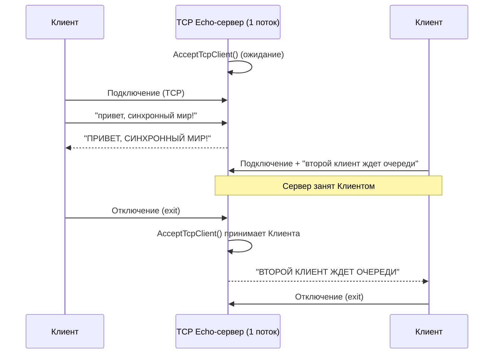

# Отчёт по заданию: Базовый синхронный TCP-сервер (Echo Server)

## 1. Постановка задачи

> **ЗАДАНИЕ. БАЗОВЫЙ СИНХРОННЫЙ СЕРВЕР**  
> Написать синхронный TCP-сервер (Echo server) и клиент к нему. Сервер принимает строку и возвращает её в верхнем регистре. Обработка одного клиента за раз (блокирующий режим).

**Репозиторий:** https://github.com/Me1l0n/Haip  
**Язык и платформа:** C# (.NET 9.0, `System.Net.Sockets`)

---

## 2. Описание проделанной работы

В рамках задания разработано решение `SyncTcpEcho`, состоящее из двух консольных приложений — TCP-сервера (`TcpEchoServer`) и TCP-клиента (`TcpEchoClient`), а также пакетного скрипта `run.bat` для автоматической сборки и быстрого запуска обоих компонентов под Windows.

### Архитектура и принцип работы

1. **Синхронный блокирующий TCP-сервер (`TcpEchoServer`)**:
   - Использует `TcpListener` из пространства имён `System.Net.Sockets` и прослушивает входящие подключения на порту `5000` (порт можно переопределить аргументом командной строки).
   - Работает в **одном потоке в блокирующем режиме**: вызов `listener.AcceptTcpClient()` приостанавливает выполнение до подключения клиента.
   - После установки соединения вызывается метод `HandleClient`, который в цикле синхронно читает строки через `StreamReader.ReadLine()`, преобразует каждую строку в верхний регистр (`ToUpper()`) и отправляет обратно клиенту через `StreamWriter.WriteLine()` (`AutoFlush = true`).
   - Пока сервер обслуживает текущего клиента, новые клиенты помещаются операционной системой в очередь TCP-подключений (backlog) и ожидают завершения сеанса активного клиента. После отключения клиента сервер освобождает ресурсы (`using`) и переходит к следующему подключению.
   - Реализована корректная обработка сигнала остановки `Ctrl+C` (`Console.CancelKeyPress`) и сетевых исключений (`IOException`, `SocketException`), а также кодировка `UTF-8` без BOM для корректной работы с кириллицей.

2. **Синхронный TCP-клиент (`TcpEchoClient`)**:
   - Подключается к серверу синхронно с помощью `TcpClient.Connect(host, port)` (по умолчанию `127.0.0.1:5000`; адрес и порт можно передать аргументами).
   - В интерактивном цикле считывает строку из консоли, отправляет её серверу, блокируется на `reader.ReadLine()` в ожидании ответа и выводит полученную строку в верхнем регистре.
   - Для штатного завершения сеанса используется команда `exit`.

3. **Схема взаимодействия (блокирующий режим)**:



### Структура проекта

```text
.
├── SyncTcpEcho.sln                # Файл решения .NET
├── TcpEchoServer/
│   ├── TcpEchoServer.csproj       # Конфигурация проекта сервера (.NET 9)
│   └── Program.cs                 # Синхронный TCP Echo-сервер
├── TcpEchoClient/
│   ├── TcpEchoClient.csproj       # Конфигурация проекта клиента (.NET 9)
│   └── Program.cs                 # Синхронный TCP Echo-клиент
├── run.bat                        # Скрипт быстрого запуска (сборка + сервер + клиент)
├── .gitignore
└── README.md                      # Отчёт о проделанной работе
```

---

## 3. Инструкция по запуску

### Требования
- Установленный **.NET 9.0 SDK** (Windows / Linux / macOS).

### Быстрый запуск на Windows
Запустите файл `run.bat` (двойным кликом или из командной строки):

```bat
run.bat
```

Скрипт автоматически:
1. Соберёт решение `SyncTcpEcho.sln` в конфигурации `Release`.
2. Запустит `TcpEchoServer.exe` в отдельном окне консоли.
3. Запустит `TcpEchoClient.exe` в текущем окне для немедленного ввода сообщений.

### Ручной запуск через CLI

В первом терминале запустите сервер (порт по умолчанию `5000`):
```bash
dotnet run --project TcpEchoServer
# или с указанием порта:
dotnet run --project TcpEchoServer -- 5000
```

Во втором терминале запустите клиент:
```bash
dotnet run --project TcpEchoClient
# или с указанием адреса и порта:
dotnet run --project TcpEchoClient -- 127.0.0.1 5000
```

---

## 4. Исходный код

### Сервер (`TcpEchoServer/Program.cs`)

```csharp
using System.Net;
using System.Net.Sockets;
using System.Text;

namespace TcpEchoServer;

internal static class Program
{
    private const int DefaultPort = 5000;

    private static void Main(string[] args)
    {
        var utf8NoBom = new UTF8Encoding(encoderShouldEmitUTF8Identifier: false);
        Console.InputEncoding = utf8NoBom;
        Console.OutputEncoding = utf8NoBom;

        int port = DefaultPort;
        if (args.Length > 0 && (!int.TryParse(args[0], out port) || port is < 1 or > 65535))
        {
            Console.WriteLine($"Некорректный порт '{args[0]}'. Используется порт по умолчанию: {DefaultPort}.");
            port = DefaultPort;
        }

        var listener = new TcpListener(IPAddress.Any, port);
        bool isRunning = true;

        Console.CancelKeyPress += (_, e) =>
        {
            e.Cancel = true;
            isRunning = false;
            Console.WriteLine("\n[Сервер] Получен сигнал остановки (Ctrl+C). Завершение работы...");
            listener.Stop();
        };

        try
        {
            listener.Start();
            Console.WriteLine("==================================================");
            Console.WriteLine("   СИНХРОННЫЙ TCP ECHO-СЕРВЕР (БЛОКИРУЮЩИЙ РЕЖИМ)");
            Console.WriteLine("==================================================");
            Console.WriteLine($"[Сервер] Запущен на 0.0.0.0:{port}");
            Console.WriteLine("[Сервер] Режим работы: обработка одного клиента за раз.");
            Console.WriteLine("[Сервер] Для остановки нажмите Ctrl+C.\n");

            int clientCounter = 0;

            while (isRunning)
            {
                Console.WriteLine("[Сервер] Ожидание подключения нового клиента...");

                TcpClient client;
                try
                {
                    // Блокирующий вызов: поток останавливается до подключения клиента
                    client = listener.AcceptTcpClient();
                }
                catch (SocketException) when (!isRunning)
                {
                    break;
                }

                clientCounter++;
                HandleClient(client, clientCounter);
            }
        }
        catch (SocketException ex)
        {
            Console.WriteLine($"[Ошибка сокета] Не удалось запустить сервер на порту {port}: {ex.Message}");
        }
        finally
        {
            listener.Stop();
            Console.WriteLine("[Сервер] Остановлен.");
        }
    }

    /// <summary>
    /// Синхронная обработка одного подключённого клиента до его отключения.
    /// Пока выполняется этот метод, сервер не принимает других клиентов.
    /// </summary>
    private static void HandleClient(TcpClient client, int clientId)
    {
        string remoteEndPoint = client.Client.RemoteEndPoint?.ToString() ?? "неизвестный адрес";
        Console.WriteLine($"[{DateTime.Now:HH:mm:ss}] Клиент #{clientId} подключился ({remoteEndPoint}).");

        using (client)
        {
            try
            {
                using NetworkStream stream = client.GetStream();
                var utf8NoBom = new UTF8Encoding(encoderShouldEmitUTF8Identifier: false);
                using var reader = new StreamReader(stream, utf8NoBom, detectEncodingFromByteOrderMarks: true, leaveOpen: true);
                using var writer = new StreamWriter(stream, utf8NoBom, leaveOpen: true) { AutoFlush = true };

                string? receivedLine;
                // Блокирующее чтение строк до закрытия соединения клиентом
                while ((receivedLine = reader.ReadLine()) != null)
                {
                    Console.WriteLine($"[{DateTime.Now:HH:mm:ss}] [Клиент #{clientId}] Получено: \"{receivedLine}\"");

                    string response = receivedLine.ToUpper();
                    writer.WriteLine(response);

                    Console.WriteLine($"[{DateTime.Now:HH:mm:ss}] [Клиент #{clientId}] Отправлено: \"{response}\"");
                }
            }
            catch (IOException ex)
            {
                Console.WriteLine($"[{DateTime.Now:HH:mm:ss}] [Клиент #{clientId}] Соединение прервано: {ex.Message}");
            }
            catch (SocketException ex)
            {
                Console.WriteLine($"[{DateTime.Now:HH:mm:ss}] [Клиент #{clientId}] Ошибка сети: {ex.Message}");
            }
        }

        Console.WriteLine($"[{DateTime.Now:HH:mm:ss}] Клиент #{clientId} отключился ({remoteEndPoint}).\n");
    }
}
```

### Клиент (`TcpEchoClient/Program.cs`)

```csharp
using System.Net.Sockets;
using System.Text;

namespace TcpEchoClient;

internal static class Program
{
    private const string DefaultHost = "127.0.0.1";
    private const int DefaultPort = 5000;

    private static void Main(string[] args)
    {
        var utf8NoBom = new UTF8Encoding(encoderShouldEmitUTF8Identifier: false);
        Console.InputEncoding = utf8NoBom;
        Console.OutputEncoding = utf8NoBom;

        string host = args.Length > 0 ? args[0] : DefaultHost;
        int port = DefaultPort;

        if (args.Length > 1 && (!int.TryParse(args[1], out port) || port is < 1 or > 65535))
        {
            Console.WriteLine($"Некорректный порт '{args[1]}'. Используется порт по умолчанию: {DefaultPort}.");
            port = DefaultPort;
        }

        Console.WriteLine("==================================================");
        Console.WriteLine("             СИНХРОННЫЙ TCP ECHO-КЛИЕНТ           ");
        Console.WriteLine("==================================================");
        Console.WriteLine($"[Клиент] Подключение к серверу {host}:{port}...");

        try
        {
            // Синхронное подключение к серверу
            using var client = new TcpClient();
            client.Connect(host, port);
            Console.WriteLine("[Клиент] Подключение установлено.");
            Console.WriteLine("[Клиент] Вводите строки для отправки. Для выхода введите 'exit'.\n");

            using NetworkStream stream = client.GetStream();
            using var reader = new StreamReader(stream, utf8NoBom, detectEncodingFromByteOrderMarks: true, leaveOpen: true);
            using var writer = new StreamWriter(stream, utf8NoBom, leaveOpen: true) { AutoFlush = true };

            while (true)
            {
                Console.Write("Введите строку > ");
                string? input = Console.ReadLine();

                if (input is null || input.Equals("exit", StringComparison.OrdinalIgnoreCase))
                {
                    Console.WriteLine("[Клиент] Завершение сеанса...");
                    break;
                }

                // Синхронная отправка строки серверу
                writer.WriteLine(input);

                // Блокирующее ожидание ответа от сервера
                string? response = reader.ReadLine();
                if (response is null)
                {
                    Console.WriteLine("[Клиент] Сервер закрыл соединение.");
                    break;
                }

                Console.WriteLine($"Ответ сервера  < {response}\n");
            }
        }
        catch (SocketException ex)
        {
            Console.WriteLine($"[Ошибка подключения] Не удалось подключиться к {host}:{port}: {ex.Message}");
            Console.WriteLine("Убедитесь, что сервер запущен и слушает указанный порт.");
        }
        catch (IOException ex)
        {
            Console.WriteLine($"[Ошибка обмена данными] Соединение с сервером потеряно: {ex.Message}");
        }

        Console.WriteLine("[Клиент] Работа завершена.");
    }
}
```

### Скрипт быстрого запуска (`run.bat`)

```bat
@echo off
chcp 65001 >nul
setlocal
cd /d "%~dp0"

echo [1/3] Сборка решения SyncTcpEcho...
dotnet build SyncTcpEcho.sln -c Release --nologo -v minimal
if errorlevel 1 (
    echo.
    echo [Ошибка] Не удалось собрать проект. Убедитесь, что установлен .NET 9 SDK.
    pause
    exit /b 1
)

echo [2/3] Запуск TCP Echo-сервера в отдельном окне...
start "TCP Echo Server" cmd /k "chcp 65001 >nul && TcpEchoServer\bin\Release\net9.0\TcpEchoServer.exe"

timeout /t 1 /nobreak >nul

echo [3/3] Запуск TCP Echo-клиента...
echo.
TcpEchoClient\bin\Release\net9.0\TcpEchoClient.exe

echo.
pause
```

---

## 5. Результаты тестирования и вывод консоли

Для проверки работы были выполнены сборка решения и сквозной тест:
1. Запущен сервер на порту `5000`.
2. Подключён **Клиент #1**, отправлены строки на английском и русском языках.
3. Во время активной сессии **Клиента #1** подключён **Клиент #2** и отправил сообщение — в соответствии с блокирующим режимом сервер не прервал обслуживание первого клиента, а принял второго сразу после отключения первого.

### Вывод консоли сборки (`dotnet build`)

```text
  Определение проектов для восстановления...
  Все проекты обновлены для восстановления.
  TcpEchoServer -> TcpEchoServer\bin\Release\net9.0\TcpEchoServer.dll
  TcpEchoClient -> TcpEchoClient\bin\Release\net9.0\TcpEchoClient.dll

Сборка успешно завершена.
    Предупреждений: 0
    Ошибок: 0
```

### Вывод консоли сервера (`TcpEchoServer`)

```text
==================================================
   СИНХРОННЫЙ TCP ECHO-СЕРВЕР (БЛОКИРУЮЩИЙ РЕЖИМ)
==================================================
[Сервер] Запущен на 0.0.0.0:5000
[Сервер] Режим работы: обработка одного клиента за раз.
[Сервер] Для остановки нажмите Ctrl+C.

[Сервер] Ожидание подключения нового клиента...
[13:51:53] Клиент #1 подключился (127.0.0.1:56397).
[13:51:53] [Клиент #1] Получено: "hello tcp server"
[13:51:53] [Клиент #1] Отправлено: "HELLO TCP SERVER"
[13:51:53] [Клиент #1] Получено: "привет, синхронный мир!"
[13:51:53] [Клиент #1] Отправлено: "ПРИВЕТ, СИНХРОННЫЙ МИР!"
[13:51:54] [Клиент #1] Получено: "C# .NET 9 echo test 123"
[13:51:54] [Клиент #1] Отправлено: "C# .NET 9 ECHO TEST 123"
[13:51:55] Клиент #1 отключился (127.0.0.1:56397).

[Сервер] Ожидание подключения нового клиента...
[13:51:55] Клиент #2 подключился (127.0.0.1:56398).
[13:51:55] [Клиент #2] Получено: "второй клиент ждет очереди"
[13:51:55] [Клиент #2] Отправлено: "ВТОРОЙ КЛИЕНТ ЖДЕТ ОЧЕРЕДИ"
[13:51:55] Клиент #2 отключился (127.0.0.1:56398).

[Сервер] Ожидание подключения нового клиента...
```

### Вывод консоли Клиента #1 (`TcpEchoClient`)

```text
==================================================
             СИНХРОННЫЙ TCP ECHO-КЛИЕНТ
==================================================
[Клиент] Подключение к серверу 127.0.0.1:5000...
[Клиент] Подключение установлено.
[Клиент] Вводите строки для отправки. Для выхода введите 'exit'.

Введите строку > hello tcp server
Ответ сервера  < HELLO TCP SERVER

Введите строку > привет, синхронный мир!
Ответ сервера  < ПРИВЕТ, СИНХРОННЫЙ МИР!

Введите строку > C# .NET 9 echo test 123
Ответ сервера  < C# .NET 9 ECHO TEST 123

Введите строку > exit
[Клиент] Завершение сеанса...
[Клиент] Работа завершена.
```

### Вывод консоли Клиента #2 (`TcpEchoClient` — ожидание очереди)

```text
==================================================
             СИНХРОННЫЙ TCP ECHO-КЛИЕНТ
==================================================
[Клиент] Подключение к серверу 127.0.0.1:5000...
[Клиент] Подключение установлено.
[Клиент] Вводите строки для отправки. Для выхода введите 'exit'.

Введите строку > второй клиент ждет очереди
Ответ сервера  < ВТОРОЙ КЛИЕНТ ЖДЕТ ОЧЕРЕДИ

Введите строку > exit
[Клиент] Завершение сеанса...
[Клиент] Работа завершена.
```

---

## 6. Выводы

В ходе выполнения задания был реализован базовый синхронный TCP Echo-сервер и клиент к нему на языке C# (.NET 9.0). Тестирование подтвердило корректное преобразование входящих строк (включая кириллицу и смешанный текст) в верхний регистр, стабильную работу в блокирующем режиме с последовательным обслуживанием одного клиента за раз, а также удобный быстрый запуск проекта с помощью скрипта `run.bat`.
