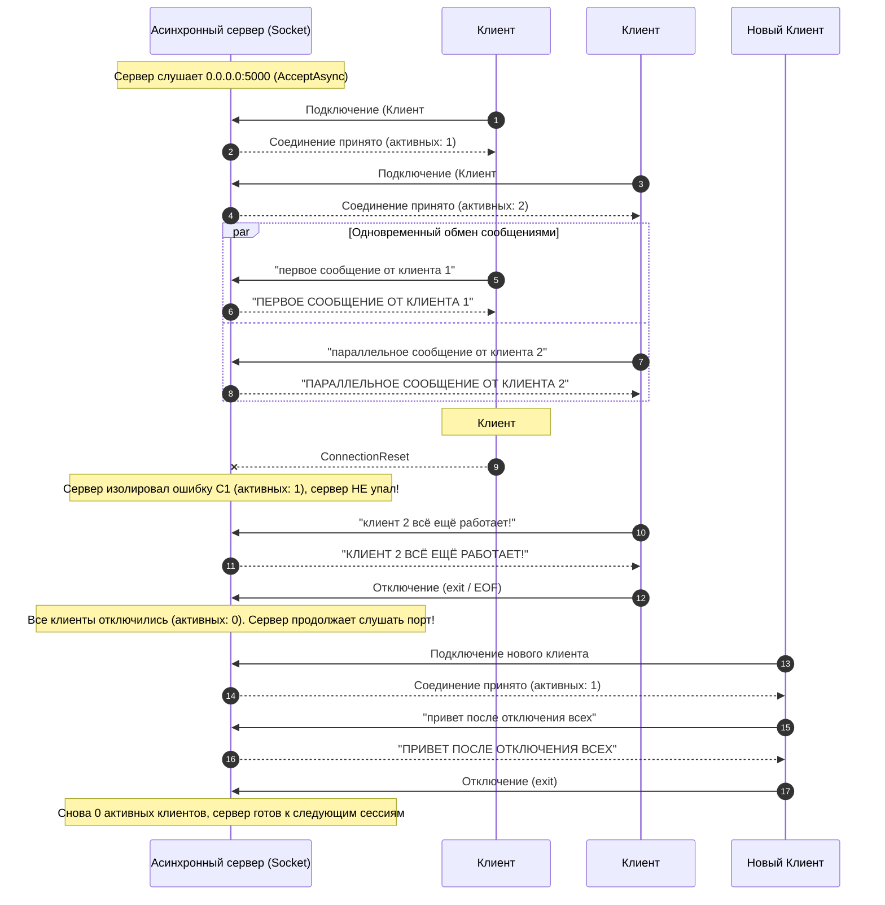

# Отчёт по заданию: Асинхронный TCP Echo-сервер с параллельной обработкой клиентов

## 1. Постановка задачи

> **ЗАДАНИЕ. АСИНХРОННЫЙ СЕРВЕР НА СОКЕТАХ**  
> Переписать сервер, используя асинхронные сокеты. Сервер должен обрабатывать несколько клиентов одновременно без блокировки основного потока. Кроме того, в программе должна быть предусмотрена обработка отключения клиента без падения сервера.  
> Также необходимо предусмотреть: если все клиенты отключатся, сервер должен продолжать работу и успешно принимать новых клиентов.

**Репозиторий проекта:** https://github.com/Me1l0n/-  
**Язык и платформа:** C# (.NET 9.0, `System.Net.Sockets`, Task-based Asynchronous Pattern)

---

## 2. Описание проделанной работы

Серверная часть решения была полностью переписана на **асинхронные сокеты** (`System.Net.Sockets.Socket`). Вместо однопоточного блокирующего ожидания реализована неблокирующая многопоточная асинхронная архитектура, обеспечивающая одновременную работу произвольного числа клиентов, отказоустойчивость при внезапном разрыве соединения и возможность непрерывной работы при отключении всех клиентов.

### Архитектурные решения

1. **Использование асинхронных сокетов (`Socket`)**:
   - Серверный сокет создаётся напрямую через конструктор `Socket(AddressFamily.InterNetwork, SocketType.Stream, ProtocolType.Tcp)` и переводится в режим ожидания с размером очереди `backlog: 100`.
   - Принятие входящих подключений осуществляется с помощью асинхронного неблокирующего вызова `await listenerSocket.AcceptAsync(cts.Token)`.

2. **Неблокирующая одновременная обработка нескольких клиентов**:
   - После завершения `AcceptAsync` основной цикл не ожидает завершения работы с клиентом. Вместо этого вызывается независимая асинхронная задача `_ = Task.Run(() => HandleClientAsync(...))`.
   - Основной поток моментально возвращается к ожиданию следующего подключения на `AcceptAsync`. Таким образом, каждый клиент обрабатывается в пуле потоков независимо, а задержки одного клиента никак не сказываются на других.

3. **Обработка отключений и отказоустойчивость**:
   - Внутри метода `HandleClientAsync` предусмотрена многоуровневая изоляция исключений:
     - `line is null` — клиент штатно завершил сеанс (отправил `exit` или закрыл соединение / EOF).
     - `IOException` с `SocketException (ConnectionReset)` — аварийное закрытие процесса клиента (например, принудительное завершение задачи через диспетчер, падение процесса, обрыв связи).
     - `SocketException` / `IOException` — любые другие сетевые сбои.
     - `OperationCanceledException` — корректная остановка сервера по `Ctrl+C`.
   - При возникновении ошибки соединение с данным клиентом закрывается, сокет корректно освобождается (`Shutdown` + `Close` + `Dispose`), а сам сервер **продолжает бесперебойную работу**.

4. **Логика непрерывного ожидания и возобновления (когда все клиенты отключились)**:
   - Ведётся потокобезопасный учёт активных клиентов с помощью `Interlocked.Increment` и `Interlocked.Decrement`.
   - Если количество активных клиентов уменьшается до `0`, цикл прослушивания сокета не завершается: сервер выводит информационное сообщение `[Сервер] Все клиенты отключились. Сервер ожидает новых подключений...` и остаётся в состоянии готовности принять новое подключение. При подключении нового клиента сервер принимает его штатно.

---

### Схема параллельного взаимодействия



---

## 3. Структура проекта

```text
.
├── SyncTcpEcho.sln                # Файл решения .NET
├── TcpEchoServer/
│   ├── TcpEchoServer.csproj       # Конфигурация проекта сервера (.NET 9)
│   └── Program.cs                 # Асинхронный сервер на сокетах (мультиклиент)
├── TcpEchoClient/
│   ├── TcpEchoClient.csproj       # Конфигурация проекта клиента (.NET 9)
│   └── Program.cs                 # Асинхронный клиент
├── run.bat                        # Скрипт быстрого запуска нескольких клиентов
├── .gitignore
└── README.md                      # Данный отчёт о проделанной работе
```

---

## 4. Инструкция по запуску

### Требования
- Установленный **.NET 9.0 SDK** (Windows / Linux / macOS).

### Быстрый запуск на Windows (скрипт `run.bat`)
Запустите `run.bat`:
1. Решение автоматически собирается в конфигурации `Release`.
2. Запускается окно асинхронного сервера `TcpEchoServer`.
3. Открывается окно первого клиента (`Клиент-1`).
4. В текущем окне запускается второй клиент (`Клиент-2`).
Вы можете одновременно отправлять сообщения из обоих клиентов, закрывать любое окно и наблюдать параллельную обработку и устойчивость сервера.

### Ручной запуск через терминал

1. Запуск сервера:
   ```bash
   dotnet run --project TcpEchoServer
   ```
2. Запуск произвольного количества клиентов (в отдельных терминалах):
   ```bash
   dotnet run --project TcpEchoClient -- 127.0.0.1 5000 Клиент-1
   dotnet run --project TcpEchoClient -- 127.0.0.1 5000 Клиент-2
   ```

---

## 5. Исходный код

### Сервер (`TcpEchoServer/Program.cs`)

```csharp
using System.Net;
using System.Net.Sockets;
using System.Text;

namespace TcpEchoServer;

internal static class Program
{
    private const int DefaultPort = 5000;
    private static int _totalClientCounter = 0;
    private static int _activeClientsCount = 0;

    private static async Task Main(string[] args)
    {
        var utf8NoBom = new UTF8Encoding(encoderShouldEmitUTF8Identifier: false);
        Console.InputEncoding = utf8NoBom;
        Console.OutputEncoding = utf8NoBom;

        int port = DefaultPort;
        if (args.Length > 0 && (!int.TryParse(args[0], out port) || port is < 1 or > 65535))
        {
            Console.WriteLine($"Некорректный порт '{args[0]}'. Используется порт по умолчанию: {DefaultPort}.");
            port = DefaultPort;
        }

        using var cts = new CancellationTokenSource();

        Console.CancelKeyPress += (_, e) =>
        {
            e.Cancel = true;
            Console.WriteLine("\n[Сервер] Получен сигнал остановки (Ctrl+C). Завершение работы...");
            cts.Cancel();
        };

        // Создание асинхронного сокета TCP (IPv4, потоковый, протокол TCP)
        using var listenerSocket = new Socket(AddressFamily.InterNetwork, SocketType.Stream, ProtocolType.Tcp);

        try
        {
            listenerSocket.Bind(new IPEndPoint(IPAddress.Any, port));
            listenerSocket.Listen(backlog: 100);

            Console.WriteLine("==================================================");
            Console.WriteLine("     АСИНХРОННЫЙ TCP ECHO-СЕРВЕР (.NET 9)         ");
            Console.WriteLine("==================================================");
            Console.WriteLine($"[Сервер] Запущен на 0.0.0.0:{port}");
            Console.WriteLine("[Сервер] Режим: асинхронные сокеты, параллельная обработка клиентов.");
            Console.WriteLine("[Сервер] Для остановки нажмите Ctrl+C.\n");

            // Основной асинхронный цикл принятия входящих подключений
            while (!cts.IsCancellationRequested)
            {
                Console.WriteLine($"[Сервер] Ожидание подключений... (Активных клиентов: {_activeClientsCount})");

                Socket clientSocket;
                try
                {
                    // Асинхронное ожидание подключения без блокировки потока
                    clientSocket = await listenerSocket.AcceptAsync(cts.Token);
                }
                catch (OperationCanceledException)
                {
                    break;
                }
                catch (SocketException ex) when (cts.IsCancellationRequested || ex.SocketErrorCode == SocketError.OperationAborted)
                {
                    break;
                }

                int clientId = Interlocked.Increment(ref _totalClientCounter);
                int activeCount = Interlocked.Increment(ref _activeClientsCount);

                // Запуск обработки клиента в независимой асинхронной задаче
                // Основной поток/цикл НЕ блокируется и сразу возвращается к AcceptAsync
                _ = Task.Run(() => HandleClientAsync(clientSocket, clientId, cts.Token), CancellationToken.None);
            }
        }
        catch (SocketException ex)
        {
            Console.WriteLine($"[Критическая ошибка сокета] Не удалось запустить сервер на порту {port}: {ex.Message}");
        }
        catch (Exception ex)
        {
            Console.WriteLine($"[Ошибка] Непредвиденное исключение в сервере: {ex.Message}");
        }
        finally
        {
            try
            {
                listenerSocket.Close();
            }
            catch { }
            Console.WriteLine("[Сервер] Остановлен. Все ресурсы освобождены.");
        }
    }

    /// <summary>
    /// Асинхронная обработка индивидуального клиента.
    /// Выполняется параллельно для каждого подключённого клиента.
    /// Изолирует сетевые ошибки и неожиданные отключения клиента, предотвращая падение сервера.
    /// </summary>
    private static async Task HandleClientAsync(Socket socket, int clientId, CancellationToken serverCancellationToken)
    {
        string remoteEndPoint = socket.RemoteEndPoint?.ToString() ?? "неизвестный адрес";
        Console.WriteLine($"[{DateTime.Now:HH:mm:ss}] Клиент #{clientId} подключился ({remoteEndPoint}). Активных клиентов: {_activeClientsCount}.");

        var utf8NoBom = new UTF8Encoding(encoderShouldEmitUTF8Identifier: false);

        try
        {
            // Сетевой поток поверх асинхронного сокета
            using var stream = new NetworkStream(socket, ownsSocket: false);
            using var reader = new StreamReader(stream, utf8NoBom, detectEncodingFromByteOrderMarks: true, leaveOpen: true);
            using var writer = new StreamWriter(stream, utf8NoBom, leaveOpen: true) { AutoFlush = true };

            while (!serverCancellationToken.IsCancellationRequested)
            {
                // Асинхронное неблокирующее чтение строки от клиента
                string? line;
                try
                {
                    line = await reader.ReadLineAsync(serverCancellationToken);
                }
                catch (OperationCanceledException)
                {
                    break;
                }

                // Если line == null, клиент штатно закрыл соединение (EOF)
                if (line is null)
                {
                    Console.WriteLine($"[{DateTime.Now:HH:mm:ss}] [Клиент #{clientId}] Отправил сигнал закрытия соединения (EOF).");
                    break;
                }

                Console.WriteLine($"[{DateTime.Now:HH:mm:ss}] [Клиент #{clientId}] Получено: \"{line}\"");

                // Преобразование строки в верхний регистр
                string response = line.ToUpper();

                // Асинхронная неблокирующая отправка ответа клиенту
                await writer.WriteLineAsync(response.AsMemory(), serverCancellationToken);

                Console.WriteLine($"[{DateTime.Now:HH:mm:ss}] [Клиент #{clientId}] Отправлено: \"{response}\"");
            }
        }
        catch (IOException ex) when (ex.InnerException is SocketException sex)
        {
            // Клиент оборвал связь (например, принудительно закрыл окно процесса / Reset connection)
            Console.WriteLine($"[{DateTime.Now:HH:mm:ss}] [Клиент #{clientId}] Сетевое соединение сброшено ({sex.SocketErrorCode}).");
        }
        catch (SocketException ex)
        {
            // Прямая ошибка сокета клиента
            Console.WriteLine($"[{DateTime.Now:HH:mm:ss}] [Клиент #{clientId}] Ошибка сокета ({ex.SocketErrorCode}): {ex.Message}");
        }
        catch (IOException ex)
        {
            // Ошибка потока данных при внезапном отключении клиента
            Console.WriteLine($"[{DateTime.Now:HH:mm:ss}] [Клиент #{clientId}] Соединение разорвано: {ex.Message}");
        }
        catch (OperationCanceledException)
        {
            Console.WriteLine($"[{DateTime.Now:HH:mm:ss}] [Клиент #{clientId}] Сеанс отменён из-за остановки сервера.");
        }
        catch (Exception ex)
        {
            // Любая другая ошибка изолируется в рамках данного клиента
            Console.WriteLine($"[{DateTime.Now:HH:mm:ss}] [Клиент #{clientId}] Ошибка при обработке: {ex.Message}");
        }
        finally
        {
            // Гарантированное освобождение ресурсов сокета клиента
            try
            {
                if (socket.Connected)
                {
                    socket.Shutdown(SocketShutdown.Both);
                }
            }
            catch { }

            try
            {
                socket.Close();
                socket.Dispose();
            }
            catch { }

            int remaining = Interlocked.Decrement(ref _activeClientsCount);
            Console.WriteLine($"[{DateTime.Now:HH:mm:ss}] Клиент #{clientId} отключился ({remoteEndPoint}). Активных клиентов: {remaining}.");

            // Если все клиенты отключились, сервер сообщает о готовности принять новых
            if (remaining == 0)
            {
                Console.WriteLine($"[{DateTime.Now:HH:mm:ss}] [Сервер] Все клиенты отключились. Сервер ожидает новых подключений...\n");
            }
        }
    }
}
```

### Клиент (`TcpEchoClient/Program.cs`)

```csharp
using System.Net.Sockets;
using System.Text;

namespace TcpEchoClient;

internal static class Program
{
    private const string DefaultHost = "127.0.0.1";
    private const int DefaultPort = 5000;

    private static async Task Main(string[] args)
    {
        var utf8NoBom = new UTF8Encoding(encoderShouldEmitUTF8Identifier: false);
        Console.InputEncoding = utf8NoBom;
        Console.OutputEncoding = utf8NoBom;

        string host = args.Length > 0 ? args[0] : DefaultHost;
        int port = DefaultPort;

        if (args.Length > 1 && (!int.TryParse(args[1], out port) || port is < 1 or > 65535))
        {
            Console.WriteLine($"Некорректный порт '{args[1]}'. Используется порт по умолчанию: {DefaultPort}.");
            port = DefaultPort;
        }

        string clientName = args.Length > 2 ? args[2] : "Клиент";

        Console.WriteLine("==================================================");
        Console.WriteLine($"      АСИНХРОННЫЙ TCP ECHO-КЛИЕНТ ({clientName})   ");
        Console.WriteLine("==================================================");
        Console.WriteLine($"[Клиент] Подключение к серверу {host}:{port}...");

        using var client = new TcpClient();

        try
        {
            // Асинхронное подключение к серверу
            await client.ConnectAsync(host, port);
            Console.WriteLine("[Клиент] Подключение успешно установлено.");
            Console.WriteLine("[Клиент] Вводите строки для отправки. Для выхода введите 'exit'.\n");

            using NetworkStream stream = client.GetStream();
            using var reader = new StreamReader(stream, utf8NoBom, detectEncodingFromByteOrderMarks: true, leaveOpen: true);
            using var writer = new StreamWriter(stream, utf8NoBom, leaveOpen: true) { AutoFlush = true };

            while (true)
            {
                Console.Write($"{clientName} > ");
                string? input = Console.ReadLine();

                if (input is null || input.Equals("exit", StringComparison.OrdinalIgnoreCase))
                {
                    Console.WriteLine("[Клиент] Завершение сеанса...");
                    break;
                }

                if (string.IsNullOrWhiteSpace(input))
                {
                    continue;
                }

                // Асинхронная отправка строки
                await writer.WriteLineAsync(input);

                // Асинхронное ожидание ответа от сервера
                string? response = await reader.ReadLineAsync();
                if (response is null)
                {
                    Console.WriteLine("[Клиент] Сервер закрыл соединение.");
                    break;
                }

                Console.WriteLine($"Ответ сервера  < {response}\n");
            }
        }
        catch (SocketException ex)
        {
            Console.WriteLine($"[Ошибка подключения] Не удалось связаться с сервером {host}:{port}: {ex.Message}");
            Console.WriteLine("Убедитесь, что сервер запущен и доступен по указанному адресу.");
        }
        catch (IOException ex)
        {
            Console.WriteLine($"[Ошибка обмена данными] Соединение с сервером потеряно: {ex.Message}");
        }
        catch (Exception ex)
        {
            Console.WriteLine($"[Непредвиденная ошибка] {ex.Message}");
        }

        Console.WriteLine("[Клиент] Работа завершена.");
    }
}
```

---

## 6. Результаты сквозного тестирования

Было проведено комплексное тестирование сценариев:
1. **Параллельное подключение двух клиентов одновременно** (Клиент-1 и Клиент-2).
2. **Одновременный обмен сообщениями**: сервер возвращает ответы в верхнем регистре обоим клиентам без взаимных блокировок.
3. **Аварийное отключение Клиента-1** (принудительный `kill` процесса со сбросом TCP-соединения): сервер перехватывает сброс соединения, не падает и продолжает работу.
4. **Проверка Клиента-2**: продолжает успешно отправлять и получать данные после падения Клиента-1, после чего штатно завершает сеанс (`exit`).
5. **Состояние 0 клиентов**: активных клиентов становится 0, сервер остаётся активным и ожидает новые подключения.
6. **Подключение нового Клиента-3 после отключения всех**: новый клиент успешно подключается, обменивается данными и завершает сеанс.

### Вывод консоли сервера (`TcpEchoServer`)

```text
==================================================
     АСИНХРОННЫЙ TCP ECHO-СЕРВЕР (.NET 9)         
==================================================
[Сервер] Запущен на 0.0.0.0:5000
[Сервер] Режим: асинхронные сокеты, параллельная обработка клиентов.
[Сервер] Для остановки нажмите Ctrl+C.

[Сервер] Ожидание подключений... (Активных клиентов: 0)
[Сервер] Ожидание подключений... (Активных клиентов: 1)
[Сервер] Ожидание подключений... (Активных клиентов: 2)
[13:03:51] Клиент #2 подключился (127.0.0.1:53934). Активных клиентов: 2.
[13:03:51] Клиент #1 подключился (127.0.0.1:53933). Активных клиентов: 2.
[13:03:51] [Клиент #2] Получено: "параллельное сообщение от клиента 2"
[13:03:51] [Клиент #1] Получено: "первое сообщение от клиента 1"
[13:03:51] [Клиент #2] Отправлено: "ПАРАЛЛЕЛЬНОЕ СООБЩЕНИЕ ОТ КЛИЕНТА 2"
[13:03:51] [Клиент #1] Отправлено: "ПЕРВОЕ СООБЩЕНИЕ ОТ КЛИЕНТА 1"
[13:03:52] [Клиент #1] Получено: "async socket test #1"
[13:03:52] [Клиент #2] Получено: "async socket test #2"
[13:03:52] [Клиент #1] Отправлено: "ASYNC SOCKET TEST #1"
[13:03:52] [Клиент #2] Отправлено: "ASYNC SOCKET TEST #2"
[13:03:52] [Клиент #1] Сетевое соединение сброшено (ConnectionReset).
[13:03:52] Клиент #1 отключился (127.0.0.1:53933). Активных клиентов: 1.
[13:03:53] [Клиент #2] Получено: "клиент 2 всё ещё работает после падения клиента 1!"
[13:03:53] [Клиент #2] Отправлено: "КЛИЕНТ 2 ВСЁ ЕЩЁ РАБОТАЕТ ПОСЛЕ ПАДЕНИЯ КЛИЕНТА 1!"
[13:03:53] [Клиент #2] Отправил сигнал закрытия соединения (EOF).
[13:03:53] Клиент #2 отключился (127.0.0.1:53934). Активных клиентов: 0.
[13:03:53] [Сервер] Все клиенты отключились. Сервер ожидает новых подключений...

[Сервер] Ожидание подключений... (Активных клиентов: 1)
[13:03:54] Клиент #3 подключился (127.0.0.1:54004). Активных клиентов: 1.
[13:03:55] [Клиент #3] Получено: "привет, я подключился после того как все отключились!"
[13:03:55] [Клиент #3] Отправлено: "ПРИВЕТ, Я ПОДКЛЮЧИЛСЯ ПОСЛЕ ТОГО КАК ВСЕ ОТКЛЮЧИЛИСЬ!"
[13:03:55] [Клиент #3] Отправил сигнал закрытия соединения (EOF).
[13:03:55] Клиент #3 отключился (127.0.0.1:54004). Активных клиентов: 0.
[13:03:55] [Сервер] Все клиенты отключились. Сервер ожидает новых подключений...
```

### Вывод консоли Клиента #2

```text
==================================================
      АСИНХРОННЫЙ TCP ECHO-КЛИЕНТ (Клиент-2)   
==================================================
[Клиент] Подключение к серверу 127.0.0.1:5000...
[Клиент] Подключение успешно установлено.
[Клиент] Вводите строки для отправки. Для выхода введите 'exit'.

Клиент-2 > Ответ сервера  < ПАРАЛЛЕЛЬНОЕ СООБЩЕНИЕ ОТ КЛИЕНТА 2

Клиент-2 > Ответ сервера  < ASYNC SOCKET TEST #2

Клиент-2 > Ответ сервера  < КЛИЕНТ 2 ВСЁ ЕЩЁ РАБОТАЕТ ПОСЛЕ ПАДЕНИЯ КЛИЕНТА 1!

Клиент-2 > [Клиент] Завершение сеанса...
[Клиент] Работа завершена.
```

### Вывод консоли Клиента #3 (подключение после отключения всех)

```text
==================================================
      АСИНХРОННЫЙ TCP ECHO-КЛИЕНТ (Клиент-3)   
==================================================
[Клиент] Подключение к серверу 127.0.0.1:5000...
[Клиент] Подключение успешно установлено.
[Клиент] Вводите строки для отправки. Для выхода введите 'exit'.

Клиент-3 > Ответ сервера  < ПРИВЕТ, Я ПОДКЛЮЧИЛСЯ ПОСЛЕ ТОГО КАК ВСЕ ОТКЛЮЧИЛИСЬ!

Клиент-3 > [Клиент] Завершение сеанса...
[Клиент] Работа завершена.
```

---

## 7. Выводы

1. **Асинхронность**: Сервер полностью переведён на асинхронные сокеты (`Socket.AcceptAsync`, асинхронный ввод-вывод потоков), что позволило устранить блокировку основного потока.
2. **Параллельность**: Реализовано независимое обслуживание произвольного количества клиентов без взаимных очередей и ожидания.
3. **Отказоустойчивость**: Любые аварийные отключения клиентов (сброс связи, принудительное завершение) изолируются и не приводят к падению сервера.
4. **Непрерывность работы**: При отключении всех клиентов сервер автоматически переходит в режим ожидания и моментально принимает новые входящие соединения.
5. **Удобство запуска**: Скрипт `run.bat` позволяет в один клик собрать проект и запустить сервер и нескольких клиентов для демонстрации одновременной работы.
